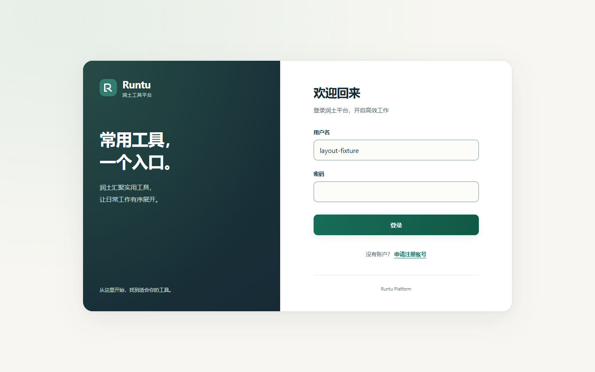
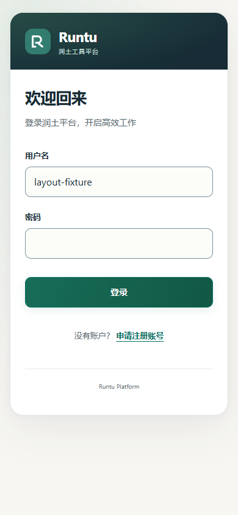
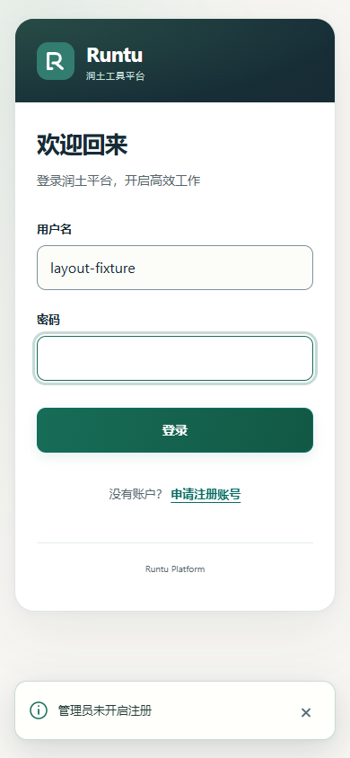
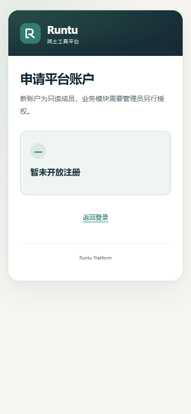

# 认证页面与临时注册提示（TASK-0038 / TASK-0039 / TASK-0040）

登录为角色中立入口，标题“欢迎回来”，副标题“登录润土平台，开启高效工作”；角色与权限继续由后端决定。共享认证布局使用深灰蓝、翡翠绿、暖白与系统字体，桌面双栏面板收紧至1040px/约600px，品牌说明精简为工具平台入口；移除架构图、弧线与旧宣传文字。手机保留品牌头和紧凑表单，无外部字体、图片或依赖。

注册入口为同一句“没有账户？ 申请注册账号”。点击先查询公开策略：enabled=true才进入/register；false留在/login弹出“管理员未开启注册”；404/503/网络失败留页弹出“注册服务暂不可用，请稍后再试”，不能冒充关闭。查询中忽略重复点击，当前组件内成功结果复用10秒，失败不缓存；离页取消查询并忽略晚到响应。提交时仍由后端再次校验策略，未自动开关注册。

AuthToast组件单独拥有显示/计时生命周期，底部浮层不阻断表单，不调用alert或抢焦点。role=status、aria-live=polite、aria-atomic播报消息；出现后约3.2秒自动淡出，支持关闭按钮，重复触发重新计时，关闭/卸载清理计时器。200ms淡入和180ms淡出在prefers-reduced-motion下关闭。

直接/register仍可匿名访问并独立读取策略：开启显示表单；关闭为简洁关闭提示和返回登录；查询失败为服务不可用和返回链接。关闭/失败均无注册表单或刷新按钮。保留注册提交的既有安全/格式错误语义及密码清空。

字段label、autocomplete、44px以上目标、Tab顺序、清晰焦点保留；文字和主要按钮至少4.5:1、输入边界至少3:1。复用原登录、CSRF、同源Cookie、returnTo、会话失效和owner审核权限；未修改后端/迁移/真实数据，也未重启已有服务。

验证使用全API浏览器夹具1440/390/360，含toast出现/自动消失/手动关闭/重复点击、注册启用/关闭/404/503/网络失败、减少动态效果、离页取消、登录401/403/503及原模块/审核回归。Node28项和生产构建通过；CI实际结果见PR和协调状态。所有截图为隔离夹具、密码为空，过渡结束后捕获并目视检查。

