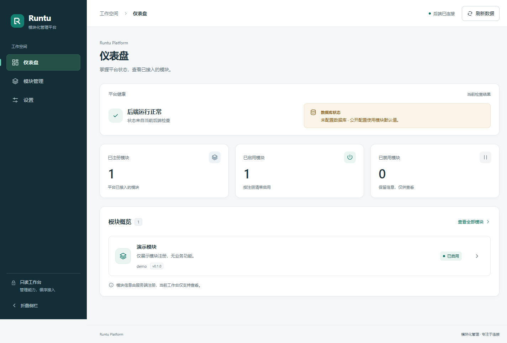
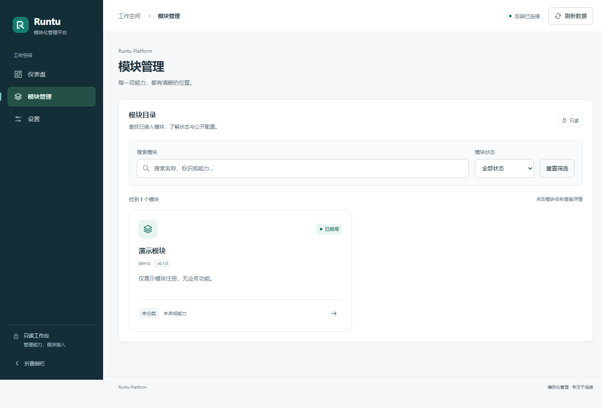
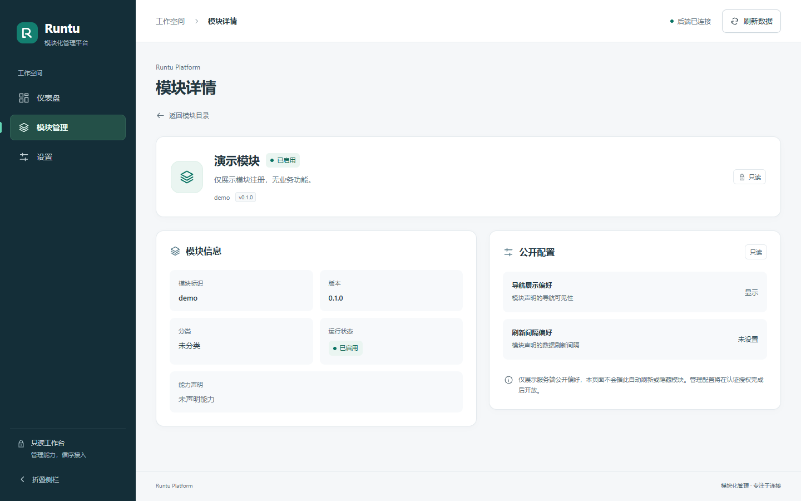
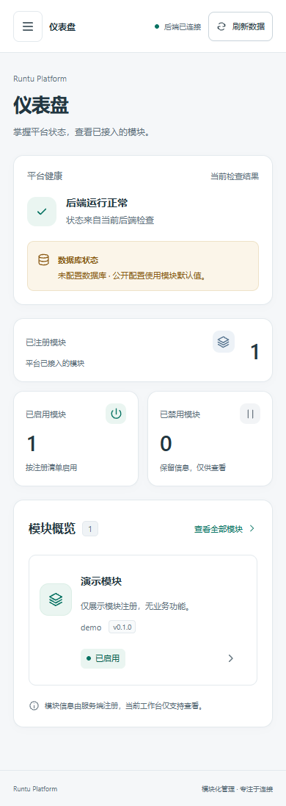
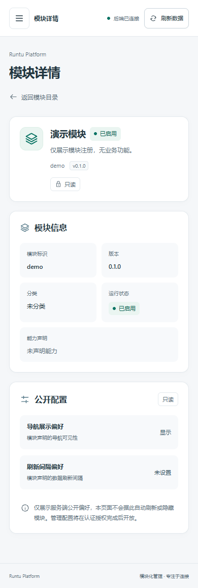
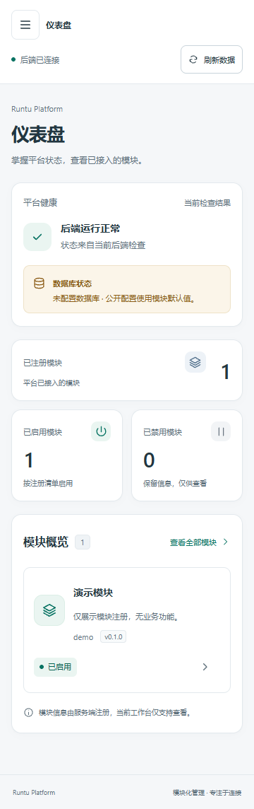
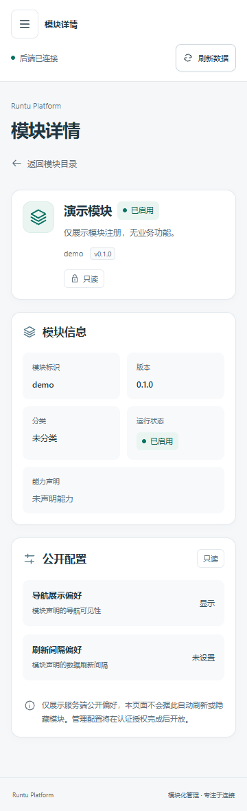

# Design System v2 · TASK-0011

## 设计选择

用户指出旧界面不够现代、缺少质感。本次对导航、运行摘要、统计、模块目录和详情重新设计；所有展示仍来自原只读 API，没有新增业务能力。

比较了两种有实质区别的方案：

| 方向 | 布局与风格 | 优点与代价 |
| --- | --- | --- |
| 全浅色内容工作台 | 暖白画布、白色窄侧栏、以文字和细分割组织列表；健康摘要嵌入页首，统计偏排版式 | 内容轻盈，适合大量文本；与用户指出的旧版灰白界面相距较近，导航边界和品牌记忆较弱 |
| 墨蓝导航与冷白内容（实现） | 稳定的深墨蓝侧栏、冷白工作区、翡翠绿品牌/激活态；紧凑运行摘要、独立 KPI 卡片、模块卡片、两列详情区 | 导航与内容层级明确，适合长期扩展的模块控制台；需认真处理深色导航对比度和窄屏抽屉 |

选择第二种。主视觉只集中在品牌与导航，不添加装饰图、渐变、虚构图表或无功能头像/铃铛。内容左对齐，用一致图标、字号、间距和语义色组织真实信息，不复制第三方模板。

桌面结构：

```text
┌──────────┬──────────────────────────────────────────┐
│ 品牌     │ 工作空间 / 当前页       连接状态  刷新  │
│ 导航     ├──────────────────────────────────────────┤
│          │ 标题与说明                               │
│          │ 紧凑后端状态       数据库检查说明         │
│          │ 注册卡片          启用卡片    禁用卡片   │
│          │ 模块概览 / 模块目录 / 双区详情           │
│ 只读提示 │                                          │
└──────────┴──────────────────────────────────────────┘
```

手机采用完整重排：可关闭抽屉，390px 保持紧凑工具栏，360px 将状态/刷新放入第二行；统计为“总数横卡 + 启用/禁用双卡”，详情两区纵排，元信息仍保留双列小网格。没有只把桌面布局缩窄。

## 相对原截图的具体改进

| 原界面 | 本次实现 |
| --- | --- |
| 浅灰简陋侧栏、字符图标 | 244px 墨蓝导航，本地 SVG 品牌字标和统一 24×24 线图标，明确激活背景、侧边标识，底部只读说明 |
| 标题与按钮层级弱 | 简洁路径提示、后端状态点、独立刷新操作；主标题 28px，中文系统字体，说明文字与内容层级清楚 |
| 大块健康提示占位 | 后端检查与数据库语义分区；未配置数据库用克制琥珀色说明，降级状态如实显示 |
| 横线分隔的三个数字 | 三张有标签、数字、语义图标和真实含义说明的 KPI 卡片；失败显示“—”，不用零冒充 |
| 单调模块列表 | 模块标记、名称/版本、分类/能力、状态和详情入口分层；搜索筛选组成独立工具区 |
| 横线表格式详情 | 模块摘要 + 模块信息网格 + 公开配置说明卡；空值有明确回退、长值可换行、只读边界清楚 |
| 手机简单缩窄 | 390px/360px 的专门重排、可关闭抽屉、40–44px 主要触控入口、保留键盘焦点循环与导航落点 |

旧截图可在 `docs/images/task-0010/` 与 `docs/images/task-0009/` 对比；下方全部为本次真实默认后端截图。

## 视觉规则与组件边界

`frontend/src/style.css` 统一定义语义 tokens：

- 画布 `#f5f7f9`、白色表面、深墨蓝文字 `#223641`、次要文字 `#60717c`。
- 导航 `#142e38`、品牌/交互 `#087363`、浅绿状态底；琥珀表示数据库未配置，红色表示错误，不用纯颜色代替文字。
- 系统中文字体，标题 28px、区域标题 16px、正文 13–14px、辅助信息 11–12px；数字使用等宽数字，不引入外部字体。
- 4/8/12/16/24/32/40px 间距级别、8/14px 圆角、轻边框与克制阴影。焦点环 3px，导航深色表面使用浅绿焦点环；移动导航边界保持 760px。
- hover/focus 使用边框/背景；交互过渡仅约 150ms，不做自动轮播或装饰动画；尊重 prefers-reduced-motion。

AppIcon 仅提供本地 SVG 视觉，不新增行为；BrandMark 为本地 SVG 品牌符号。页面保留现有数据和请求生命周期；路由、props/events、取消和 generation 防竞态逻辑沿用父版本。没有 TypeScript 迁移、UI 框架、新依赖、外部资源、CSS 构建依赖或遥测。

## 实际验证

正式基线 `codex/TASK-0010-routing-polish`，SHA `52cd46e5c6405afec34dfbd5658f1db26f23c12f`；领取时 #10 open、未合并，远程父分支与任务一致。分支 `codex/TASK-0011-premium-ui`，PR base 精确指向父分支，不修改 #3–#10 原分支或 PR。

- Python 3.14.0：`python -m pytest tests -q`，22 passed；保留原有 Starlette/httpx 弃用警告。
- Node 24.19.0：`node --test frontend/tests/ui.test.js frontend/tests/navigation.test.js frontend/tests/design.test.js`，8 passed。
- pnpm 11.25.0：`pnpm run build` 通过，依赖和锁文件不变。
- 现有 Windows Chrome + 实际 FastAPI:8000/Vite:5173，`node frontend/tests/browser-smoke.mjs` 通过。测试视口为 1440×900、390×844、360×800；截图采用浏览器 full-page capture，可高于视口以完整呈现内容。
- 三种宽度均验证直接访问、刷新、未知路由、详情前进后退、搜索条件保留、菜单标题、导航焦点、无水平溢出；移动抽屉的 Escape、Tab/Shift-Tab 焦点循环、打开时后退均验证，未见 JS 运行时异常。
- 保留原错误/空态测试。空列表、禁用模块、数据库 ready/降级503、详情503、断网/加载/重试，以及重复长名称/无空格长能力值来自**明确的浏览器网络夹具**，不代表真实 PostgreSQL 验证；没有写入后端数据。
- 检查 prefers-reduced-motion 下过渡时长为 0；新增对比度测试从 CSS 读取 tokens，核心文字色对均达到 4.5:1：正文/画布 11.70、正文/白底 12.56、次文/画布 4.71、次文/白底 5.06、品牌/白底 5.76、警告色对 5.36、错误色对 5.97、导航次文/导航底 7.05。此结果不等同于完整 WCAG 或读屏审计。

浏览器脚本沿用已有 Chrome 和 Node 内置模块，不下载依赖，不关闭沙箱。运行前启动两个本地服务，从仓库根执行脚本；测试专用 9229 端口须空闲，结果及隔离 Chrome 配置保存在 `.git/codex-coordination/ui11/`，不提交浏览器缓存。路由/静态 fallback 的说明仍见 DEVELOPMENT.md。

## 真实 API 截图

这里未使用网络夹具：默认后端仅注册演示模块，没有数据库配置；截图中的 1/1/0 和未配置提示均来自真实 API。没有补造第二个模块或“更好看”的业务指标。

### 桌面仪表盘 · 1440×900 视口



### 桌面模块管理 · 1440×900 视口



### 桌面模块详情 · 1440×900 视口



### 手机仪表盘 · 390×844 视口



### 手机模块详情 · 390×844 视口



### 360px 补充验收




## 已知边界

视觉品质仍需用户依据实际截图审阅，不用“高级”替代证据。尚未进行完整读屏/跨浏览器审计、自动像素差分基准或真实 PostgreSQL 在线验证。辅助文字较正文小，后续可按用户反馈调整密度；当前无暗色主题。所有功能仍为只读，没有认证/写入/生产部署能力变更，不自动合并。没有修改 Skills、AGENTS.md、GitHub 信号、其他 PR、服务器或 ACTIVE 三分钟任务。
