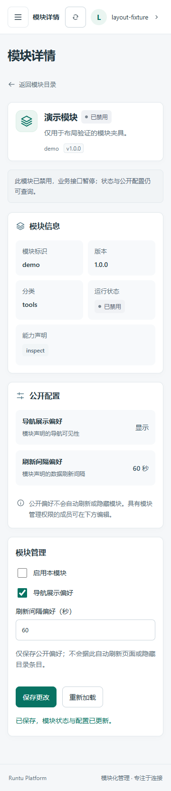
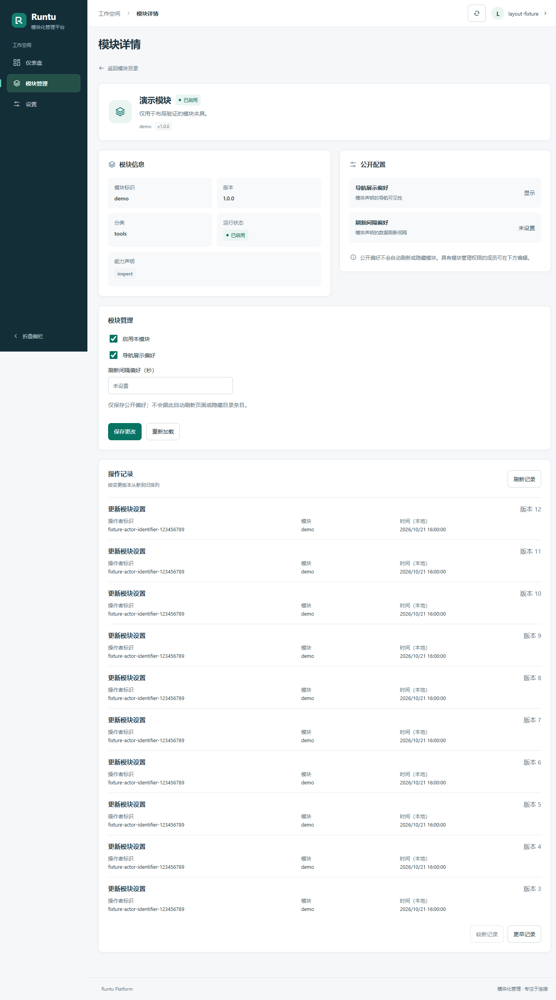

# 模块管理第一阶段（TASK-0025）

## 审计结论及最小方案

原模块清单被冻结在注册表中，路由仅在启动时按启用状态挂载，公开配置已有独立持久化服务；RBAC 已明确授予 owner/admin `module.manage`，模块自身业务写接口仍被统一边界拒绝。直接改变注册表或仅改浏览器状态都不能形成可重载的管理闭环。

采用数据库状态覆盖，不动态安装/导入模块代码：

- `module_configs.enabled` 可空，NULL 保留原注册状态，兼容旧配置行；`revision` 从 0 开始，用于并发检测。
- 列表与详情读取相同有效状态；所有已注册路由预先挂载，逐请求经过状态门禁。禁用后业务接口 404，元数据仍可读；重新启用无须重启。存储不可用时返回 503，不猜测启用状态。OpenAPI 仍按启动时注册状态展示业务路由，不能用其显示与否替代运行时门禁。
- 冻结的注册元数据 `required=True` 保护必需模块；它必须声明为 enabled，旧的 disabled 覆盖也不能禁用它。认证、RBAC 等核心路由不属于可管理模块目录，不能通过此接口关闭。
- 不执行安装、上传、路径/文件编辑、任意配置、动态代码执行；不卸载 Python 对象或强行取消已开始的请求，不声称可停止未来插件的后台任务。模块注册仍是受信代码边界。

## API 与权限

`PUT /api/admin/modules/{module_id}` 要求现有同源/会话校验、`module.manage` 与有效防伪证明。只接受：

```json
{"enabled":false,"expected_revision":0,"public_config":{"show_in_navigation":true,"refresh_interval_seconds":30}}
```

两项公开偏好严格类型校验，刷新间隔为 null 或 1..86400 整数；未知字段和秘密配置不接受。成功返回更新后的公开详情及 revision，不返回审计身份或任何敏感字段。输入错误只返回通用 422，不回显原始请求值。

| 身份/条件 | 读取公开元数据 | 写状态/公开配置 |
| --- | --- | --- |
| owner、admin，具有 module.manage | 允许 | 正常会话、防伪及来源检查后允许 |
| viewer | 允许 | 403 |
| 匿名、失效或已撤销会话 | 允许 | 401 |
| 已登录但缺失/无效防伪证明，或来源不符 | 不改变原公开读策略 | 403 |
| 禁用 required 模块 | 允许 | 403 |
| 未知模块 | 404 | 鉴权后 404 |
| 版本冲突 / 存储不可用 | 按实际读取结果 | 409 / 503 |

原模块业务 POST 等写方法仍一律 403，即便 owner 也不能借模块管理开启任意业务写入。禁用模块业务接口为 404。

## 事务、幂等及审计

事务内再次检查操作者 active 和实时角色权限，初始化缺失配置行，使用锁及 revision 条件更新。冲突不覆盖他人的配置。相同目标状态与配置的重复请求（版本不超前）返回当前结果，不增加版本或重复审计；不同内容使用过期版本返回 409。

新 `module_changes` 表与配置修改同事务提交：仅记录随机操作 ID、模块 ID、操作者内部 ID、版本、动作类别和 UTC 时间，不保存公开配置值、请求体、密码、会话、防伪值或网络来源。审计插入失败时配置与状态一起回滚。模块与版本唯一约束避免重复事件。TASK-0028 的模块内查询见下节。

## 模块操作记录（TASK-0028）

`GET /api/admin/modules/{module_id}/changes?limit=10&before_revision=20` 复用现有会话、来源和实时 `audit.read` 检查。owner/admin 为 200，viewer 为 403，匿名/会话失效为 401；非可信来源仍拒绝。GET 不需要防伪证明，不产生模块写入。数据库/记录不可用为通用 503，不返回底层错误，所有返回为 `Cache-Control: no-store`。合法身份的未知模块为 404，禁用模块仍可查询。

按路径限定单个已注册模块；`limit` 为 1..50（默认10），`before_revision` 为 1..2147483647 的排他上界。不接受自定义 SQL、排序或无界导出。按模块内唯一 revision 降序查 `limit+1` 条，返回 `items` 及 `next_before_revision`（无更多为 null）。复用 0004 的 `(module_id,revision)` 唯一索引；无需新迁移。后续新写入不会挤动较旧分页，刷新才能看到较新记录；向前翻页会重新查询，不声明跨请求快照或长期留存策略。

记录固定输出 `module_id, actor_id, action, created_at, revision`，动作目前只含 `updated`。操作者为不透明内部 ID，不关联读取用户名、账户、密码、会话或配置值；时间统一 UTC，页面显式按本地时间展示。读取故障不会冒充“暂无记录”。事务失败及精确重复保存不产生额外记录。

模块详情页的独立 `ModuleAudit` 组件拥有请求取消、空/加载/错误状态和双向游标历史；根级权限资源作为输入，不另建身份栏。无 `audit.read` 不发请求，权限丢失/模块切换会取消并清除记录；服务端仍逐请求独立鉴权。每页10条，支持刷新、较新/更早记录；成功保存后按新 revision 刷新。接口失效/403清除旧记录并提示。Vue 3 Composition API 与 JavaScript 保持原架构及依赖。

验证覆盖临时 SQLite 的权限、参数边界、固定字段、模块过滤、相同时间的稳定排序、并发插入时分页、空页、幂等及失败回滚；同一分页 HTTP 合约加入受保护 PG 容器 CI（七项必过、零跳过）。前端 API 合约与全API拦截浏览器夹具覆盖记录加载、分页、空状态、刷新、403/503、匿名/viewer不请求及1440/390/360布局。真实开发数据库的审计数据不读取、不修改，本任务不迁移或重启真实服务。截图为明确测试夹具。

前端统一复用根组件持有的服务端权限资源，详情页提供受控表单、禁用确认、保存结果、重新加载及冲突/失败提示。匿名/viewer 没有写入表单，服务端仍独立强制验证。偏好字段只表示存储的公开偏好，不自动刷新页面或隐藏目录条目。写入超时可能发生在服务器提交之后，必须重新加载确认，不自动重试副作用。

## 迁移与运维边界

新增可审查迁移 `0004_module_management`：仅增加状态覆盖/版本列及操作审计表，旧公开配置保留，不清空账户或会话。启动不会自动迁移。代码审查及 PR 合并后，操作员在确认目标为隔离开发库并完成备份后，手动执行现有 `python -m alembic upgrade head`，再重启其掌控的后端进程。此任务没有对用户开发库执行迁移，没有更改环境配置、重新引导管理员或重启已有服务。

未执行 0004 时，新应用对配置存储明确返回不可用，不能把旧 schema 的状态当作正常。降级至 0003 会删除状态覆盖、版本及新操作审计，并回到代码声明的默认状态，可能重新启用原先手动禁用的模块；必须先停止写入并审查影响，不自动降级。其他旧迁移自身的既有回滚影响不变。

## 验证记录

本地 Python **85 passed、6 PostgreSQL online skipped**，Node **14 passed**，生产构建通过。新增覆盖状态切换、初始禁用后启用、required 保护、owner/admin/viewer/匿名、防伪、注销会话、严格输入、幂等、版本冲突、同库并发、审计失败回滚、重新创建应用后持久性及旧 schema 升降迁移。所有迁移/写入只在临时测试库执行。

现有受保护的 PostgreSQL 容器 CI 新增一项模块管理写入/并发/重载测试，总计 6 项在线测试，执行器精确校验六项通过、零跳过。Windows 本机无 Docker，不能将本地跳过冒充 PG 通过；线上实际结果由 PR 检查与任务状态文件记录。

实际 Chrome 隔离 API 夹具覆盖 1440/390/360 布局、已有登录/角色/退出行为、保存状态与间隔、重载后显示、409/503 不误报成功、匿名及 viewer 隐藏表单。夹具不是用户真实模块写入验收，未向真实开发库提交写请求。

正式任务已确认用户真实浏览器登录 owner、Ctrl+R 保持及退出完成，本次不重复要求登录、不覆盖 TASK-0021/0024 旧状态；该用户确认加上此前匿名 401 检查，不等于独立证明用户原会话 Cookie 在服务端失效。临时测试会话的注销/撤销拒绝已自动测试。



本次 Windows 隔离验收：Python 99 passed、7 PostgreSQL online skipped；Node 17 passed；生产构建与 Chrome 1440/390/360 全 API 夹具通过。PG 实际执行结果另见 PR 检查，不将本机跳过计为在线通过。


