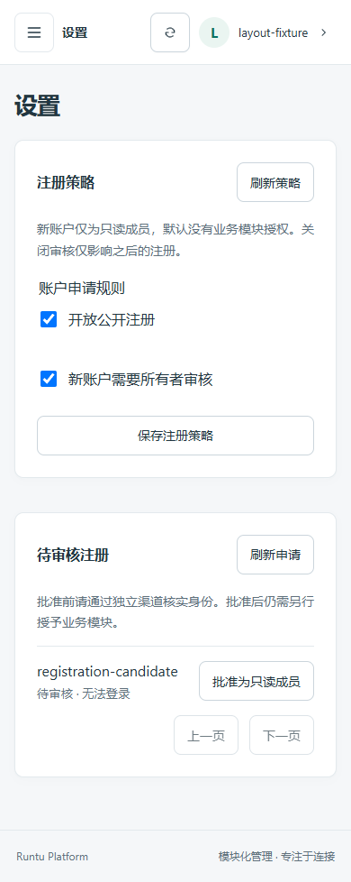
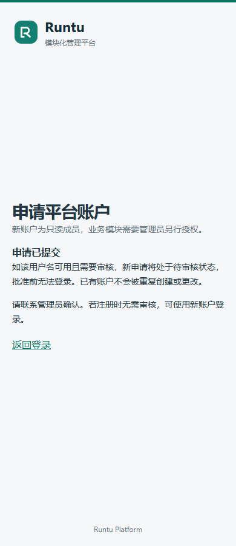

# Registration policy and approval boundary

TASK-0034 design: a singleton policy defaults to disabled registration and required
approval. Only a current active owner with `users.manage`, a valid session, trusted
origin and CSRF proof may change it. Revision checks prevent stale policy writes.
Public registration always creates viewer accounts without module grants or sessions.

Pending registrations are inactive users with a separate pending marker. Login and
existing authenticated APIs already reject inactive users. Generic user edits cannot
activate or promote a pending registration; a dedicated owner approval transaction
sets viewer/active and marks approval atomically with audit. Disabling approval in
policy applies only to future submissions, never activates existing pending users.
Duplicate names receive the same generic submission acknowledgement; no account lookup
or anonymous registration-status endpoint is exposed. No automatic login or password delivery.

Writes share the existing bootstrap singleton mutex and authentication rate-limit
storage. Anonymous signup requires an unexpired anonymous CSRF session, consumed in
the creation transaction. Policy is rechecked under the mutex; stale/revoked owner
sessions are checked again there. Hashing uses existing Argon2 settings and bounded
verification slots. Source/global/name buckets bound attempts, including duplicates.
Audit contains event kind, user ID and hashed source only, never request bodies.

Migration 0006 creates the policy singleton and pending-registration table, without
modifying existing user rows. Downgrade refuses while pending applications exist:
dropping pending markers could let old user editors bypass approval. Otherwise it
loses policy and approval history only. Back up and review before separately
authorizing a real migration; application startup never migrates. Missing storage
fails closed with 503. Health readiness does not prove registration schema readiness.

UI follows the existing teal/slate admin theme and system Chinese typography. Settings
owns only the policy draft and submission. User Management owns an independent application
directory and review dialog with pagination, confirmation and refresh. Registration is a separate auth-layout form with native
password input cleared on submit/unmount. Disabled and pending states are textual,
without suggesting that an account was necessarily created for a duplicate name.

This foundation does not provide email verification, CAPTCHA, password recovery,
deletion, notifications or distributed edge abuse protection. Pending users
reserve their username; operator approval requires independent identity verification.
The process-wide hashing limit is per worker; database buckets are shared. Rate-limit
records use the existing cleanup lifecycle. Public enablement is an owner decision.

User role/status editing now also requires the 0006 approval-marker table; missing
tables fail closed rather than allowing a pending-account bypass. Existing accounts
are not rewritten by upgrade, and ordinary authentication remains unchanged.

Validation includes temporary SQLite migration/model consistency, pending downgrade
refusal, default-off, owner/admin/viewer matrix, CSRF/origin/body limits, duplicate
and rate-limit behavior, anonymous-context consumption, policy changes during hashing,
concurrent creation/approval, stale policy revision, audit rollback and revoked owner
session checks. The owned PostgreSQL CI suite runs the HTTP registration contract,
concurrent policy changes, audit rollback, model check and downgrade/re-upgrade.
Chrome uses intercepted APIs only at 1440/390/360; captures below contain fixture
identities and no entered passwords.

## TASK-0049 unified review center and rejection

User Management now separates actual accounts from registration applications. The
existing `/api/admin/users` list excludes every unapproved application, so pending
or rejected submissions are never counted as enabled or merely disabled accounts.
Approved applications join the normal account directory. The owner-only review list
supports `state=pending` (default) or `state=rejected`; GET application details
returns only id, username, review state and submission time. Both use no-store.
Global Settings contains registration policy only, with a link to User Management.

POST `/api/admin/registrations/{id}/reject` reuses current owner/session/Origin/CSRF
checks, the shared bootstrap mutex and transactional audit. It writes exactly one
`registration_rejected` decision in the existing auth audit and removes any target
sessions. It never enables the user, changes the role or grants tools. A repeated
identical decision is idempotent; an opposing decision returns 409. Concurrent
approve/reject operations serialize, with exactly one outcome. An audit failure
rolls back the operation. Revoked or non-owner sessions cannot review.

No new table, field or migration is introduced. The legacy `pending` marker remains
true for ALL unapproved applications, including rejected submissions. The durable
rejection event distinguishes the display state. This deliberately preserves the
existing generic-edit, grant, inactive-login and downgrade safeguards. Rejected
usernames stay reserved; rejection cannot be reversed through these APIs. Decision
events are canonical records and must not be purged as expendable authentication
logs. Any future retention/deletion or reversal policy requires explicit design and
migration; there is no automatic cleanup or downgrade workaround here.

This task changes code and isolated tests only. It does not migrate the real local
SQLite or restart its running backend. The new detail/reject API requires the new
backend code to be activated under a separate authorized local operation; the UI
must show an error if that service is not available, never report a fake rejection.
Custom role/status comboboxes provide listbox semantics, arrows/Home/End/Enter/Escape,
click-outside closure and viewport positioning, including inside the native modal.
