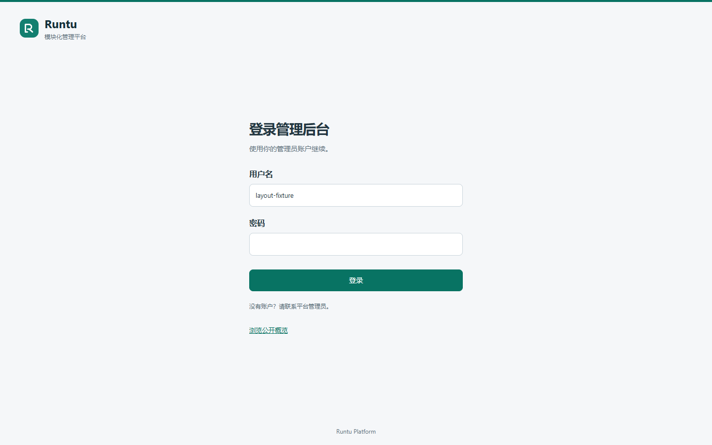
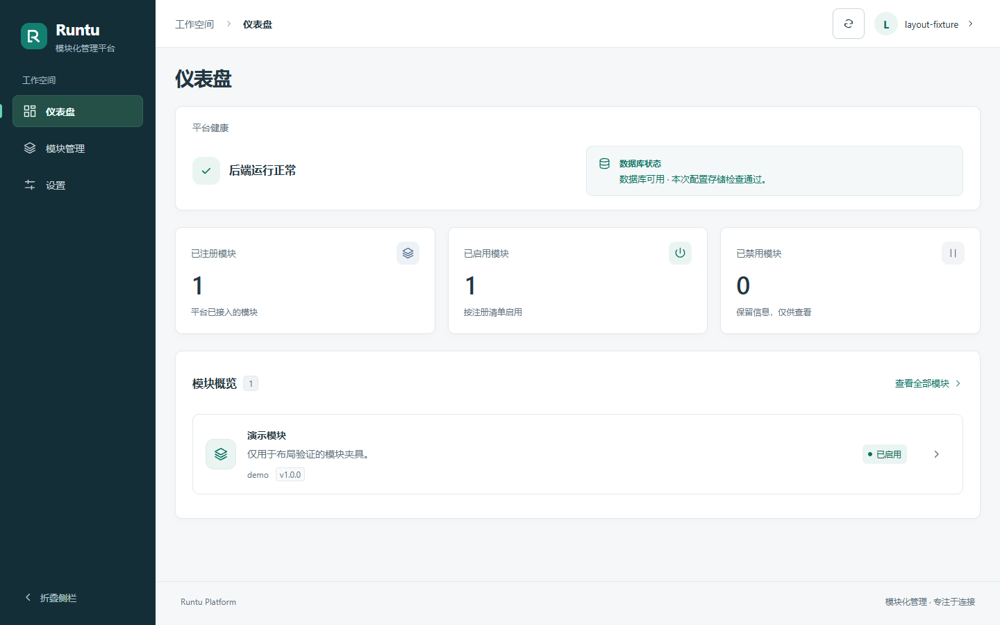
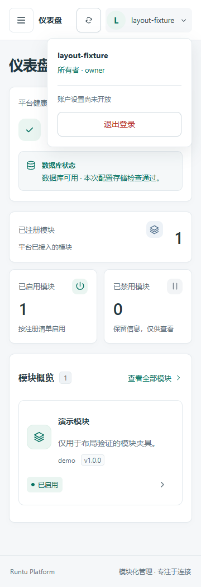
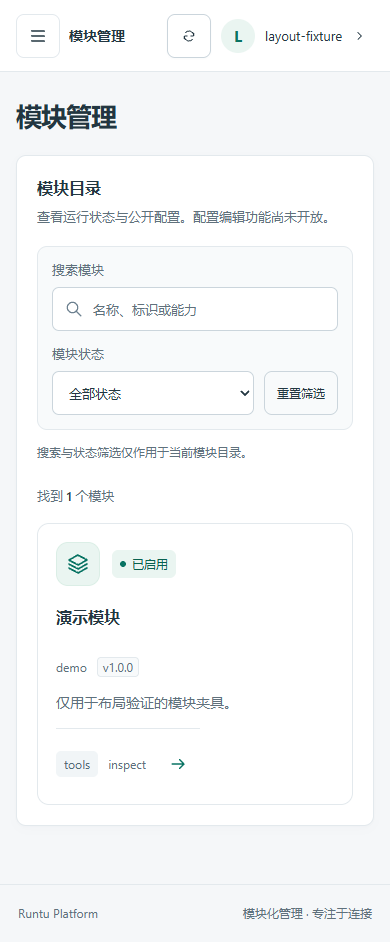

# TASK-0022 登录与后台布局验收

登录页从后台外壳独立出来：只保留品牌、表单和公开概览入口。登录成功或已确认登录访问 `/login` 时返回仪表盘；首次身份查询有等待状态，重新确认身份不会清空正在填写的用户名。

后台沿用深蓝导航、青绿色交互色及系统中文字体，收窄侧栏、压缩标题和设置页留白。顶部统一账户菜单负责身份、服务端角色及退出；正文不再展示身份调试条或权限胶囊。菜单使用原生 details/summary，支持键盘及 Escape 返回触发器，点击外部关闭。保留窄屏导航焦点约束、折叠导航和跳过导航入口。

根组件拥有唯一身份资源与路由协调；AuthLayout 只负责认证布局，AppLayout 只负责后台布局，UserMenu 拥有角色查询、退出请求及菜单生命周期。继续使用 Vue 3 Composition API / JavaScript，无新依赖。角色仅来自现有服务端接口；未开放的设置与配置编辑明确说明为功能未开发，与 owner 权限无关，不增加虚假可操作入口。

## 实际验证

- `node --test frontend/tests/*.test.js`：12 passed，涵盖认证客户端、防伪请求、权限字段拒绝、路由、资源并发和文字对比度。
- `pnpm --dir frontend build`：通过。
- 后端 pytest：75 passed、5 PostgreSQL 在线测试 skipped。测试子进程显式清空数据库和认证环境覆盖，使用临时测试库；未访问本地开发库。已有 Starlette/httpx 弃用提示保留，不在本任务升级依赖。
- `node frontend/tests/layout-browser-smoke.mjs`：实际 Chrome 检查 1440、390、360 像素。所有 API 请求在浏览器中截获为明确夹具，未向真实认证后端提交用户名或密码。覆盖独立登录页、已登录重定向、身份重查保留表单、统一角色菜单、Escape、侧栏折叠、窄屏导航、刷新、退出失败与重试、退出后夹具 401、身份服务失败和未知角色拒绝展示。页面无横向溢出。
- `git diff --check`：通过。仅前端源码、测试、说明和明确夹具截图进入 PR；无环境文件、数据库、IDE 文件或凭据。

## 可复验条件与限制

布局检查从仓库根目录运行，需现有本机 Vite 服务位于 `127.0.0.1:5173` 及 Windows Chrome。脚本拒绝已占用的浏览器调试端口，只启动隔离 headless 浏览器并在结束时清理；不会启动/停止后台服务。此脚本不纳入 Node 单元测试 glob，Linux CI 仍执行单元测试和构建。

原有 `auth-browser-smoke.mjs` 与 `browser-smoke.mjs` 的 UI 选择器/文案已适配；本任务未重跑其旧的完整在线场景，不把选择器更新当作验证通过。

本次自动检查不代表真实管理员登录验收。TASK-0021 保持等待独立核验：实际管理员刷新后会话与退出后受保护 API 拒绝尚未由本任务确认。未读取密码、Cookie、会话或防伪令牌值，未执行管理员引导/迁移。此前供用户操作保留的 loopback 服务继续可用；本任务只清理自己启动的浏览器。

## 截图（全部使用布局夹具）

