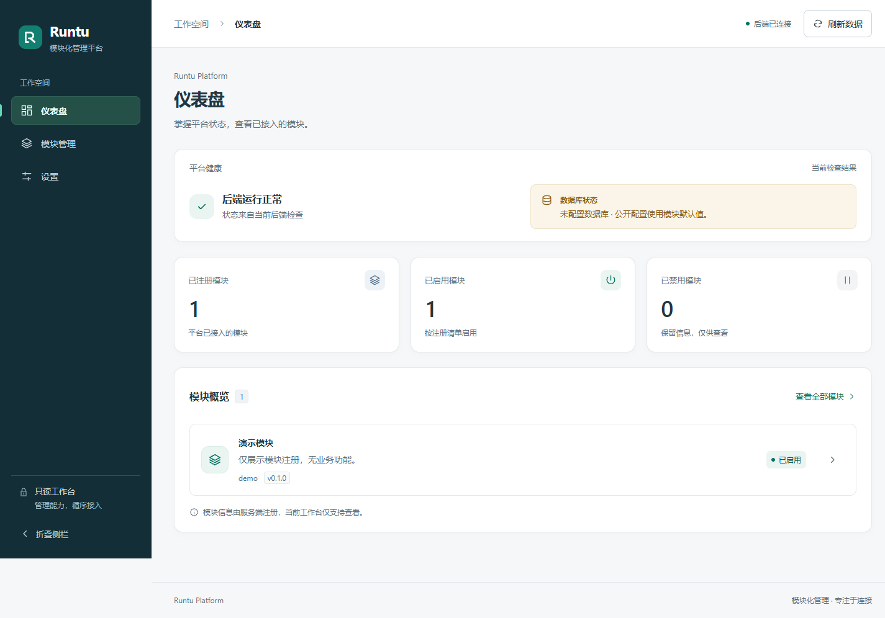
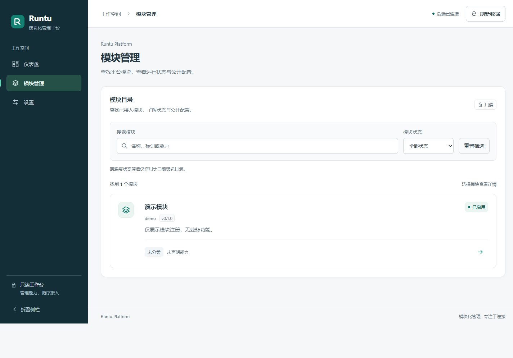
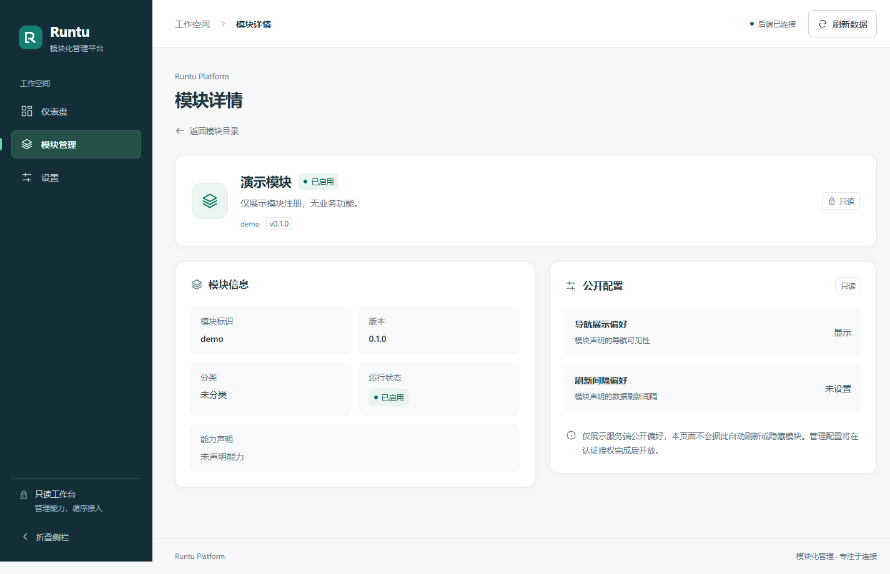
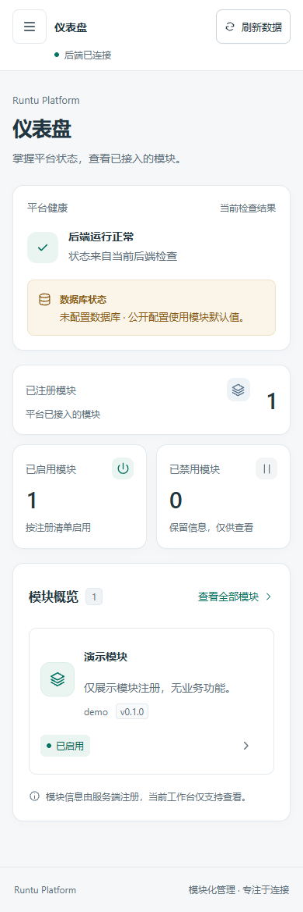
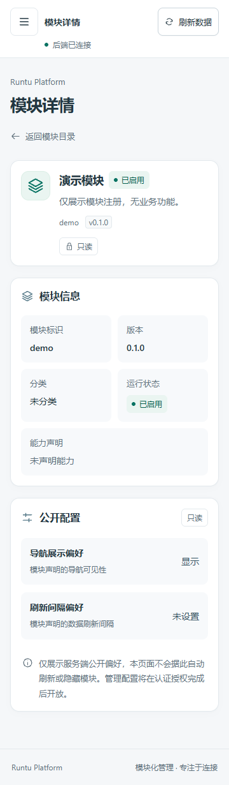
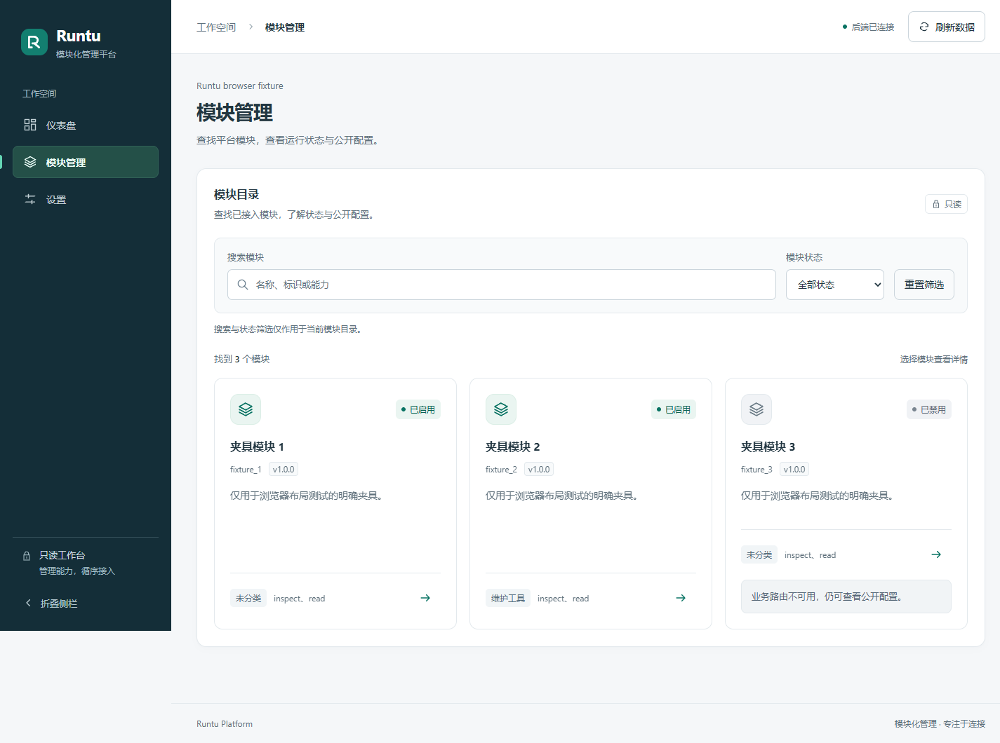
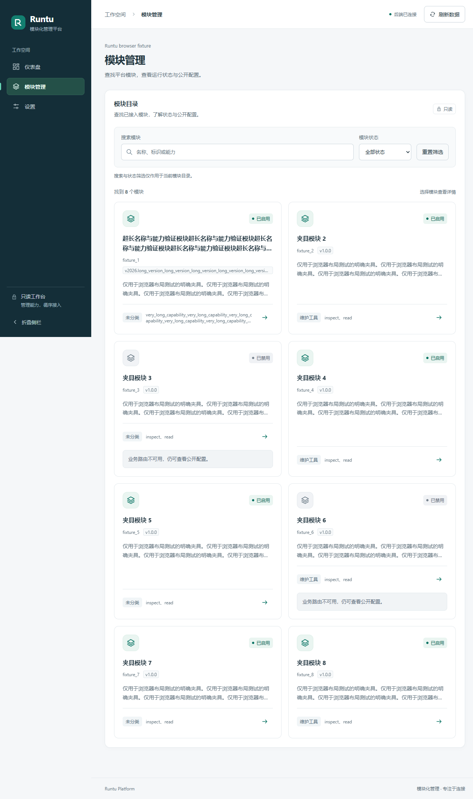

# TASK-0012 · 视觉精修与目录适配

本次沿用墨蓝导航、冷白内容与翡翠绿语义色。父基线为 `codex/TASK-0011-premium-ui` 的 `8435718acc731eaeccd1f9d649ddfbbb9e90e9d4`，领取时 PR #11 open、未合并且父分支未变。只做已发布任务要求的界面精修与后续规划，不扩展业务功能。

## 用户截图问题与改进

| 问题 | 实际调整 |
| --- | --- |
| 辅助字号过小 | 按角色调整：重要说明与表单标签 12–13px，正文/描述 14px，元信息值和公开配置值 14px；保留标题/KPI层级，导航/页脚可读性同步提升，没有盲目把所有字号乘倍数 |
| 桌面单模块占一半、右侧空缺 | `auto-fit + minmax(min(100%,300px),1fr)`；只有一个筛选结果时使用铺满的横向条目，模块标记/信息/状态/能力/入口对齐；窄屏回到纵向卡片 |
| 多模块长内容造成卡片失衡 | 名称/描述/能力摘要限制两行、版本摘要省略；完整名称留在 DOM 和原生 title，完整能力/版本仍在真实详情页。网格等高，长文本可断行，未加假模块填空 |
| 搜索筛选边界不清楚 | 明确标签、关联的搜索说明、筛选状态提示与礼貌结果通知；没有匹配时可清除筛选，原搜索/状态筛选与详情返回保留不变 |
| 模块入口小且重复停靠 | 每张目录卡只有一个真实详情链接，伪元素扩展到整卡；键盘焦点环围绕卡片，hover/focus统一。不把已禁用模块误标为不可查看，禁用仍说明业务路由不可用 |
| 仪表盘多模块概览不明确 | 紧凑说明与一致间距，0模块有空态，1–5展示实际条目，超过5明确注明“前5个/完整总数”；未配置数据库保持琥珀色语义，ready与unavailable不混淆 |
| 详情说明与值较小 | 元信息标签/值、公开配置标题/说明/值分别设定层级；长值断行和完整能力保留，只读说明提高字号，不新增表单或假保存按钮 |
| 360/390顶栏不一致 | 两种宽度统一为44px菜单/标题/刷新操作行与紧凑状态行，重要按钮目标44px；支持安全区，状态/降级文案可换行，页脚可重排 |

## 简短无障碍检查

本次检查范围为主要页面的键盘与可见性回归，**不是完整 WCAG 审计**。

- 保留 main/nav/标题、显式表单 label、按钮名称、aria-expanded、抽屉 dialog/inert 与 Escape；搜索说明使用 aria-describedby，结果状态用礼貌通知。
- 修复目录的重复详情停靠点；每卡一个原生链接，整卡可鼠标/触屏点击，键盘聚焦有3px环，仍支持复制/新标签打开。导航后主内容获得焦点，抽屉Tab/Shift-Tab循环与关闭恢复焦点保留。
- 浏览器验证主要可见控件有文字、aria-label 或关联 label；重要辅助文字不少于12px。不是对所有浏览器、屏幕阅读器或实际设备的全量审核。
- 核心文本/状态色仍由设计测试计算：次文/画布4.71:1、次文/白底5.06:1，其余核心色对5.36:1以上；字号调整没有降低这些色对的对比度。
- prefers-reduced-motion 下交互过渡为0。装饰SVG保留 aria-hidden，不引入动画或外部资源。

## 验证范围与复现

环境为 Windows、Python 3.14.0、Node 24.19.0、pnpm 11.25.0、现有 Chrome；不下载测试工具或浏览器、不关闭沙箱。

从仓库根运行：

```powershell
.\.venv\Scripts\python.exe -m pytest tests -q
node --test frontend/tests/ui.test.js frontend/tests/navigation.test.js frontend/tests/design.test.js
```

在 frontend 下运行 `pnpm run build`。启动本地 FastAPI:8000 与 Vite:5173 后，从根目录运行 `node frontend/tests/browser-smoke.mjs`。

实际结果：22项Python测试、8项Node测试、Vite生产构建通过；保留既有Starlette/httpx弃用警告。浏览器实际API回归与明确网络夹具验证通过：

- 1440×900、1280×900、390×844、360×800：直接URL、刷新、未知路由/详情404区分、前进后退、菜单/标题/焦点、筛选保留、无横向溢出和JS异常。
- 明确 `count-*` 夹具：四种宽度下0/1/3/8模块的目录与仪表盘；验证单卡铺满、只有一个链接、点击卡片边缘可到详情；多卡长名称/能力/版本与卡高、搜索空态、禁用筛选、概览实际计数/前5个说明。
- 夹具还覆盖数据库ready/降级503、禁用详情、详情503、断网/加载/重试；移动抽屉、Tab/Shift-Tab、Escape、减少动画偏好均验证。
- 对夹具拦截规则做了最小修复：限定根路径 `/api/*`，避免原先广义模式误拦截Vite的 `/src/api/client.js`。测试禁用缓存并对夹具返回no-store，确保整页刷新也使用当前夹具。产品API地址/代理均未改。

实际默认后端只有一个demo、未配置数据库。下方五张交付图全部来自真实默认后端；计数1/1/0没有伪造。浏览器full-page截图可高于指定视口高度，方便完整审阅。原始截图与隔离Chrome配置位于本地 `.git/codex-coordination/ui12/`。

## 实际后端截图

### 桌面仪表盘 · 1440×900视口



### 桌面模块目录 · 1440×900视口



### 桌面模块详情 · 1440×900视口



### 390px手机仪表盘



### 360px手机模块详情



## 明确的夹具截图（测试数据）

以下为浏览器拦截的测试数据，**不是默认后端，也不是已接入业务模块或真实数据库**。




## 规划与边界

后续能力推荐顺序在 [ROADMAP_NEXT.md](ROADMAP_NEXT.md)，区分已实现的内部存储/静态生命周期与待开发的身份、权限、审计和受保护管理写API。本任务没有实现路线图功能。

仍未做完整读屏/跨浏览器审核、自动像素差分或真实PostgreSQL在线验证；目录摘要可能截断，完整信息可进入详情查看。没有分页或虚拟列表，0/1/3/8夹具仅代表本次规模验收，不承诺任意大规模性能。色彩方向、Vue3+JavaScript和现有只读API/路由均保留，依赖/锁文件不变。

不修改后端语义、数据库schema、AGENTS.md、Skills、GitHub信号、其他PR、服务器或ACTIVE三分钟任务；不自动合并/部署。
