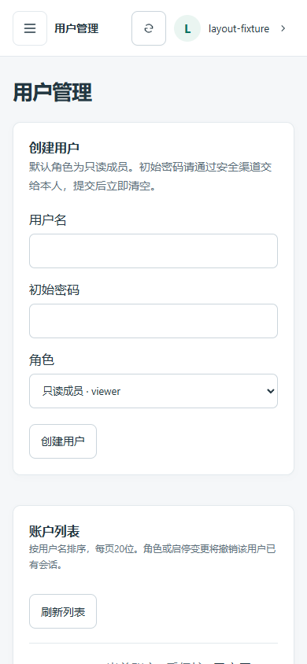

# 用户管理基础（TASK-0030）

## 权限与范围

沿用既有固定角色矩阵，只有 owner 拥有 `users.manage`。admin 仍可管理模块和查看审计，不能列出或管理用户。viewer 和匿名均无用户管理权限。没有公开注册、注册开关/审核、密码找回、邮件、用户模块授权或删除用户接口；默认创建 active 的 viewer，只有 owner 明确选择才赋予 admin/owner。

| 请求 | owner | admin / viewer | 匿名 / 无效会话 |
| --- | --- | --- | --- |
| GET 用户列表 | 200 | 403 | 401 |
| POST 创建 | 201 | 403 | 401 |
| PATCH 角色/启停 | 200，受保护条件限制 | 403 | 401 |

所有请求沿用现有 Host/Origin/Sec-Fetch-Site/安全传输要求。写入必须带同源 Origin 和有效 CSRF；来源不符可先于会话验证返回 403。响应 `Cache-Control: no-store`，错误不回显请求或数据库诊断。

## API

- `GET /api/admin/users?limit=20&after_username=user-001`：limit 1..50，用户名 3..64 位 `[a-z0-9_.-]` 游标，按不可变用户名的固定 ASCII 顺序、排他游标分页（SQLite BINARY / PG C，避免数据库 locale 与浏览器顺序不同）。返回 `items` 与 `next_after_username`，无总数查询或无界导出。新插入在已翻过区间的用户须刷新查看。PG 显式排序不保证使用默认 locale 的用户名索引；本 MVP 不新增迁移或宣称大规模列表性能已测定。
- `POST /api/admin/users`：仅 `username, password, role?`，role 默认 viewer；用户名沿用 bootstrap 规则规范化并校验，密码沿用 14..128 字符和 Argon2id 参数，不提供默认密码。重复用户名返回 409。角色只能为 owner/admin/viewer，禁止传入 `is_admin`、自定义 ID、状态或未知字段。
- `PATCH /api/admin/users/{id}`：只接受 `role, active, expected_role, expected_active`，严格布尔类型；预期状态不匹配返回 409，未知用户 404。无密码编辑或删除。精确重复更新不增加事件或撤销会话。

用户成功响应仅 `id, username, role, active, created_at`，时间为 UTC；列表投影不加载密码哈希/会话。写入体采用至多 4096 字节的流式读取和手动校验，拒绝未知字段，通用 413/415/422，不序列化 Pydantic 的原输入。密码以 SecretStr 管理，哈希在工作线程执行；HTTP/应用日志、事件、成功和错误响应均不包含密码/哈希。

## 并发与保护

复用已有 auth_users/auth_sessions/auth_events/auth_bootstrap，无模型变更、无迁移或额外依赖。每次写入先在独立事务中锁定 bootstrap 单例（无逻辑变化 UPDATE）：SQLite 获取数据库写锁，PostgreSQL 获取行锁，串行化本服务的用户变更；再检查操作者 active 与实时 users.manage。单例不存在则 fail closed，不自动引导或创建。

禁止对当前账户自我降权或禁用，即使还有其他 owner；禁止移除最后一个 active owner。检查和更新在同一锁保护事务内，两位 owner 同时互相降权时最多一个操作成功，另一个重新校验后被拒绝，不会留下零个有效 owner。这不涵盖绕过应用直接改数据库的外部操作者。

角色或启停发生变化时原子撤销目标所有会话，重新启用也不会复活旧会话；用户名和密码不变。兼容 `is_admin` 标志随角色更新，但该标志不是授权来源。最小事件 `user_created/user_updated` 只含目标 ID、时间及操作者 ID 的摘要，不记录密码、角色配置、请求体或原始来源。事件写入失败会连同账户变更与会话撤销全部回滚。HTTP 权限、同源和防伪验证仍在事务外首先执行。

## 页面

新增按需加载 `/users`，只有显式权限允许时显示导航与发出列表请求。页面复用现有身份/导航区域；`UsersPage` 拥有列表/游标/取消，`UserCreate` 拥有创建及密码输入生命周期，`UserRow` 拥有单账户编辑、确认和错误状态。Vue 3 `<script setup>` 与 JavaScript，不迁移 TypeScript。

初始密码从原生 password 输入取出后立即清空，成功/失败/卸载再次清空；不进入列表、事件、URL、localStorage/sessionStorage、截图或日志。浏览器内存中的 JS 字符串无法保证即时物理清零；请求进行中短暂存在于内存，未宣称可抵御本机调试器。创建超时结果可能已提交，提示先刷新列表，不自动重试。自我角色/状态控件禁用，其他操作确认后提交，服务端保护独立生效。

## 验证与运维

本地 Python **120 passed、8 PostgreSQL online skipped**；Node **19 passed**，生产构建通过。临时 SQLite 验证权限/CSRF/来源、非法和超长输入、重复用户名、角色提升拒绝、自我/最后 owner 保护、并发互相降权、禁用/启用、会话撤销、哈希校验、持久化、账户/会话/事件失败回滚与响应脱敏。受保护 PostgreSQL 容器 CI 纳入用户合约和并发 owner 检查，执行器要求 **8 passed、0 skipped**；真实 CI 结果见 PR/状态文件，不把本地跳过视为通过。

Chrome 全 API 夹具通过1440/390/360：权限入口、只读身份无请求、创建/禁用、初始密码清空、自身账户保护、分页、409/503恢复及既有模块/审计流程。测试密码运行时生成，截图时 password 输入必须为空。截图为明确隔离夹具。

未读取真实开发用户表、密码、会话或审计内容，未迁移、修改真实库、重启真实服务或生产部署。PR 合并后需后续明确授权才同步/重启本地后端加载新接口；本任务不创建后续任务，不自动合并。

