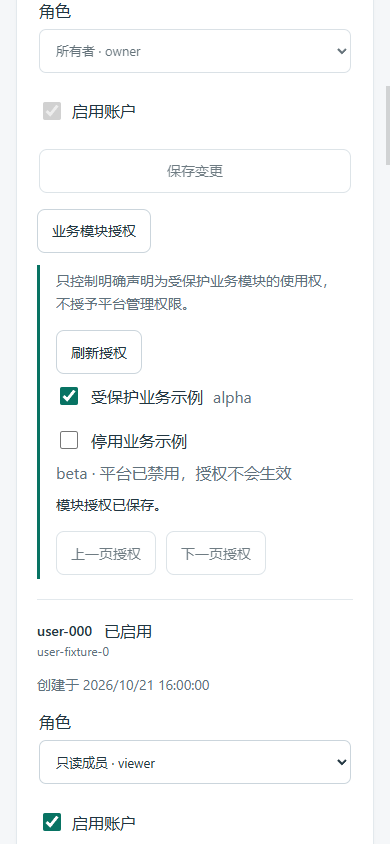
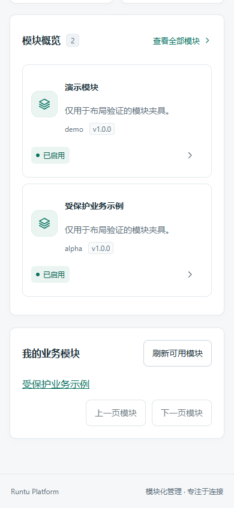

# 用户模块授权 MVP（TASK-0031）

> TASK-0036 契约更新：`GET /api/modules` 与 `GET /api/modules/{id}` 现在要求有效登录。匿名/失效会话返回401，认证未配置返回503；健康、认证/注册必要接口及显式 public 模块业务/示例端点保留原公开行为。下文旧阶段的“公开元数据/匿名工作台”描述仅代表历史实现。详见 [登录边界](LOGIN_BOUNDARIES.md)。


## 已核实的公开契约

当前正式注册仅有 DemoModule，声明“无业务功能”，router 无业务端点。已有元数据列表/详情和临时示例模块 GET 为公开契约。保持这些接口、Demo 的 public 默认模式和已有模块管理 API 行为，不把本次新增授权包装成现有/未来全部业务接口已受保护。

采用显式 opt-in `access_mode=assigned` 声明可授权业务模块；旧模块默认 public。required 或核心系统 ID 不可授权。public 模块不接受授权记录，也不会突然要求登录。元数据目录的公开可见性与业务 API 调用权独立；公开说明不能包含秘密。工作台的业务入口仅显示本人已授权且全局启用的 assigned 模块；管理身份仍可在模块管理目录查看平台元数据。

## 权限矩阵与数据

| 能力 | owner | admin | viewer | 匿名 |
| --- | --- | --- | --- | --- |
| 保留既有平台管理权限 | 既有全部 | 既有模块管理/审计 | 既有只读 | 既有公开元数据 |
| 编辑/读取其他用户业务授权 | users.manage | 拒绝 | 拒绝 | 拒绝 |
| 读取本人可用业务模块摘要 | 允许 | 允许 | 允许 | 拒绝 |
| assigned 业务 API | 需要本人显式授权且全局启用 | 同左 | 同左 | 拒绝 |
| 既有 public Demo/示例 | 保持原契约 | 保持原契约 | 保持原契约 | 保持原契约 |

管理权限不等于业务使用授权；所有新用户默认无 assigned 授权，owner 可显式给自己授权。用户停用或会话失效拒绝。全局禁用始终优先，保留授权记录便于后续重新启用，但不会绕过停用。

新增可审查 0005：用户/模块复合主键关联及最小授权变更审计（操作者、目标用户、模块、动作、UTC 时间）。不改变旧表内容；临时 SQLite/受控 PG 验证 upgrade/downgrade，降级仅丢失新授权和其审计。真实开发库不迁移、不读取、不重启。

## 原子性与接口方向

写授权复用用户管理的 bootstrap 单例锁，与角色/启停变更串行；事务内重查 actor active/users.manage、目标存在/active、注册模块可授权，原子更改关联及审计。重复同目标幂等；预期状态不符返回冲突。列表有界游标分页，按模块 ID 固定排序，不支持 SQL、任意配置或无界导出。API 复用会话、来源及写入 CSRF；响应固定公开字段、no-store，错误不回显输入/数据库诊断。

HTTP 授权写入将会话的内部摘要传入事务，锁定会话行并再次检查有效期、空闲超时及用户归属，排队期间已撤销的会话不能继续提交；摘要不会进入响应、审计或日志。受信服务内部调用仍须提供合法 actor，本依赖不授权外部直接调用内部方法。

为模块作者提供 `require_module_access(module_id)`，assigned router 自动加边界，额外应用自定义路由时显式 Depends。逐请求重查当前身份、关联和有效全局状态；已经开始的业务处理不会因之后撤权自动取消，未来写业务仍须在其业务事务中做最终授权检查。MVP 只保留原模块业务写方法拒绝策略，不新增业务写能力。

## UI 边界与验收计划

Owner 的单账户编辑组件内嵌独立授权编辑区，自己管理请求、分页、确认与取消；根用户页面不承接其内部状态。工作台独立“我的业务模块”区仅请求本人摘要，空授权/当前无 assigned 模块明确提示，不为 Demo 虚构授权开关。Vue 3 JavaScript 与现有样式保持。

后端隔离测试与受控 PG 覆盖矩阵、缺省拒绝、全局停用、目标停用、非法/核心/public 模块、幂等/并发/回滚/最小审计、迁移及公开兼容。Node、构建和全 API 浏览器夹具验证编辑/个人入口、空/错误和移动端。所有数据为测试夹具；不查看真实账户、审计、凭据或模块设置。

## 实际接口与模块接入

- `GET /api/me/modules`：认证用户的可用 assigned 模块摘要；没有授权或已停用的模块不返回。无隐式 owner/admin 业务使用豁免。
- `GET /api/admin/users/{user_id}/modules`：users.manage 可查看目标的候选模块及当前授权、全局 enabled 状态，禁用账户拒绝。当前正式 Demo 为 public，因此正常候选为空，不虚构开关。
- `PUT /api/admin/users/{user_id}/modules/{module_id}`：仅 `granted, expected_granted` 严格布尔；写入需要 CSRF 和同源 Origin。目标状态已经一致为幂等成功；其他预期不符409。不存在用户404，停用目标及不可授权模块403，认证/存储不可用503；错误通用且 no-store。
- 两个 GET 使用 `limit` 1..50（默认20）和排他 `after_module` 游标，模块 ID 升序；固定输出 `module_id,name,enabled,granted` 与 `next_after_module`，无账户凭据/配置值。

`ModuleManifest(access_mode='assigned', required=False, ...)` 才能成为候选；public 为默认且保持旧 API 不变。保留 ID `auth/authentication/core/platform/users/sessions/audit/settings` 和 required 模块不能授权。标准 registry router 挂载时对 assigned 模块自动加入依赖；其余自定义挂载路由示例（仅供模块作者，未新增正式业务模块）：

```python
from fastapi import Depends
from backend.module_access import require_module_access

@app.get('/custom-business-view', dependencies=[Depends(require_module_access('your_business_id'))])
def custom_business_view():
    return {'ok': True}
```

该模块 ID 必须在受信 registry 中声明为 assigned；不能依赖浏览器入口隐藏作为鉴权。不要重用已移除模块 ID 来承载不同安全语义；旧授权会按 ID 保留，需要操作员审查。当前 Demo 不声明 assigned，本 PR 的真实拦截证据来自隔离模块示例，不能宣称未来所有任意挂载路由已自动覆盖。

普通身份的模块目录/概览隐藏 assigned 项，业务入口从本人摘要获取；owner/admin 保留元数据管理目录。直接公开元数据 API 仍保持现有公开设计，即“知道模块存在”不等于“可以调用业务接口”。个人入口目前指向模块详情，未虚构尚不存在的业务操作页面。无既有公开契约的权限改变。

## 迁移、局限及验收

0005 只新建 `user_module_grants` 与 `user_module_grant_events`；用户/模块复合主键、用户 FK、UTC 创建时间，审计固定为操作者/目标/模块/动作/时间。没有清空旧用户、会话、模块配置。降级会丢失全部新授权及授权审计，必须由后续授权的操作员审查，不能把降级当作无损恢复。

启动不自动迁移。仅有0004时新授权查询会503（不会冒充空授权）；既有公开 Demo 元数据不依赖新授权表。不改变现有健康检查的模块配置探测范围，所以健康 ready 不等于新授权表已迁移；操作员应核对迁移 head 后再验收功能。本任务没有读取或修改真实开发 SQLite，也没有重启真实服务。合并后如需本地启用，必须先另行下发备份/迁移授权。

当前候选集合来自受信 registry，自身摘要可能为寻找已授权且启用模块扫描注册集合；响应有界，但未宣称大规模 registry 性能已验证。授权逐请求检查，不承诺撤销后强行中止已开始的请求。既有模块业务写方法仍统一禁止，本 MVP 不授予管理权限或自动执行副作用。

Windows Python 最终完整套件 **130 passed、9 online PG skipped**，包括默认Demo无虚假候选及事务内撤销会话检查。Node **21 passed**、build及Chrome全API夹具1440/390/360通过。临时SQLite升降级/元数据检查、公开兼容、标准与自定义依赖、矩阵/CSRF、停用账户和模块、幂等/并发、失败回滚及审计脱敏通过。受控PG容器CI新增对应合约、并发/回滚及迁移，严格要求 **9 passed、0 skipped**；实际CI结论见PR及状态回传。所有密码/用户/授权均为隔离测试数据，截图密码输入为空。




